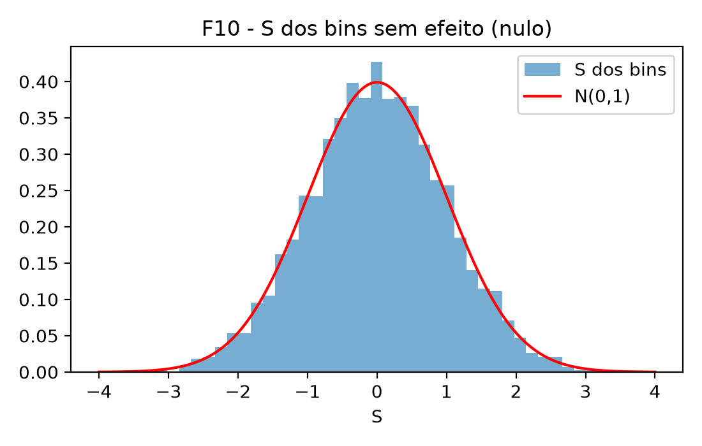

# Assimetrias entre B⁻ e B⁺ com dados simulados

## Resumo

Em decaimentos de três corpos de mésons $B^\pm$ (como $B^\pm \to p\bar{p} K^\pm$), a assimetria de carga entre estados finais de $B^-$ e $B^+$ pode variar em magnitude e trocar de sinal ao longo do espaço de fase. Esse comportamento cria um problema prático de análise estatística: quando existem sub-regiões cinemáticas com assimetrias opostas, a soma integrada sobre todo o espaço de fase promove o cancelamento mútuo entre excessos positivos e negativos, resultando em uma assimetria global próxima de zero que oculta as diferenças locais. Ao mesmo tempo, subdividir a amostra em regiões menores reduz a contagem de eventos por bin — exigindo intervalos de confiança robustos em baixa estatística — e torna a análise sensível à largura da janela de seleção e a assimetrias instrumentais de detecção.

Para investigar esse problema de forma controlada, desenvolvi simulações de Monte Carlo em Python que sorteiam contagens de Poisson para $B^-$ e $B^+$ sob perfis conhecidos de assimetria (nulo, uniforme e com inversão de sinal), avaliando o desempenho de estimadores pontuais, intervalos de confiança, cortes cinemáticos em $m(p\bar{p})$ e testes de hipóteses locais e globais no plano de Dalitz $(s_{12}, s_{23})$.

**Principais conclusões e resultados quantitativos:**
* **Detecção de diferenças locais sob cancelamento global:** Quando regiões opostas do espaço de fase possuem assimetrias que se compensam, o teste binomial aplicado à contagem total não distingue o sinal da hipótese nula, enquanto o teste qui-quadrado de homogeneidade ($\chi^2_\mathrm{hom}$) e o mapa de significâncias locais ($S_j$) recuperam a estrutura injetada no modelo. No plano de Dalitz simulado com dois blocos de sinais opostos ($N = 20\,000$), a assimetria global resulta compatível com zero ($A_\mathrm{total} = -0{,}0003$, valor-*p* binomial $0{,}97$), mas a análise particionada identifica os desvios locais (extremos de $S_j = +6{,}17$ e $-3{,}95$) e rejeita a homogeneidade espacial com $p \approx 1{,}3 \times 10^{-20}$.
* **Desempenho de intervalos de confiança em baixa estatística:** A subdivisão do espaço de fase reduz a contagem por bin ($T$), regime no qual a aproximação normal de Wald falha severamente perto das bordas físicas $\pm 1$, enquanto o intervalo de Wilson preserva cobertura adequada. Em testes de estresse com média de $\bar T \approx 10$ eventos por região e $A = 0{,}8$, a cobertura empírica de Wald cai para 63 %, contra 96 % do método de Wilson e 99 % de Clopper-Pearson. Para amostras crescentes, o erro padrão do estimador $\hat A$ confirma a escala teórica $1/\sqrt{N}$ (inclinação de $-0{,}50$ em escala log-log).
* **Otimização da janela cinemática e efeitos instrumentais:** Para um sinal localizado na massa invariante $m(p\bar{p})$, a razão sinal-ruído é maximizada por uma janela de integração de largura $b^\ast/s \approx 2{,}80$ (em unidades da dispersão $s$ do sinal), evitando tanto a perda de eventos úteis em janelas estreitas quanto a diluição estatística em janelas largas. Adicionalmente, uma assimetria instrumental de detecção não corrigida de $a = -0{,}02$ ($-2\%$) induz desvios espúrios que crescem com $\sqrt{N}$ (atingindo $6{,}32\sigma$ e 100 % de falsas rejeições em $N = 10^5$); a inversão analítica elimina esse viés, mas a precisão final em amostras grandes passa a ser limitada pela incerteza sistemática de calibração $\sigma_a$.

Todo o estudo utiliza dados simulados e conta com uma suíte automatizada de verificação numérica independente contra soluções analíticas e referências da biblioteca SciPy (`resultados/verificacao.csv`).

---

## Introdução e definição do problema

Na física de partículas, a violação da simetria de CP mede a diferença de comportamento entre processos de matéria e de antimatéria, constituindo uma das condições formuladas por Sakharov (1967) para explicar a assimetria bariônica do Universo. Embora a fase complexa da matriz CKM gere violação de CP no Modelo Padrão (Thomson, 2013), sua magnitude é insuficiente por muitas ordens de grandeza para responder pela prevalência cosmológica da matéria, motivando estudos detalhados em decaimentos de hádrons pesados.

Em decaimentos hadrônicos de três corpos sem charme, como $B^\pm \to p\bar{p} K^\pm$ (LHCb Collaboration, 2014, 2023), a dinâmica ocorre através de diferentes estados intermediários e ressonâncias que interferem no espaço de fase bidimensional (plano de Dalitz). Como as fases fortes e fracas dependem das variáveis cinemáticas, a assimetria de carga entre $B^-$ e $B^+$ não é necessariamente constante: ela pode apresentar excesso de $B^-$ em uma faixa de massa invariante e excesso de $B^+$ em outra.

A assimetria de contagens em qualquer região ou amostra é definida a partir do número de eventos observados de $B^-$ ($N^-$) e de $B^+$ ($N^+$):

$$A = \frac{N^- - N^+}{N^- + N^+}.$$

Se o espaço de fase for composto por sub-regiões $i$ com frações de eventos $w_i$ ($\sum w_i = 1$) e assimetrias locais $A_i$, a assimetria global integrada será a média ponderada $A_\mathrm{total} = \sum w_i A_i$. Consequentemente, quando regiões distintas possuem assimetrias de sinais opostos ($A_i > 0$ e $A_j < 0$), seus efeitos se subtraem na soma global, podendo resultar em $A_\mathrm{total} \approx 0$ mesmo na presença de fortes assimetrias locais.

Este repositório investiga computacionalmente esse problema metodológico. As publicações experimentais citadas servem para definir as massas, os limites cinemáticos e a motivação fenomenológica, mas **não são utilizados dados reais de detectores**: defino os parâmetros verdadeiros no arquivo `config.json`, gero contagens pseudoaleatórias de Poisson e avalio sob quais condições os métodos estatísticos recuperam as estruturas programadas no modelo.

## Notação

| Símbolo | Significado |
|---|---|
| $N^-$, $N^+$ | Contagens de eventos de $B^-$ e $B^+$, sorteadas de distribuições de Poisson |
| $T = N^- + N^+$ | Contagem total observada no subespaço analisado (amostra total, região $i$ ou bin $j$) |
| $N$, $N_\mathrm{exp}$ | Número esperado de eventos na amostra total ($10^3, 10^4$ e $10^5$ na etapa 1; $20\,000$ na etapa 3) |
| $\lambda$ | Média da distribuição de Poisson para a contagem $T$ ($\lambda = N w_i$ na região $i$) |
| $k$, $M$ | Número de regiões cinemáticas ($k = 10$) e número de repetições de Monte Carlo ($M = 2000$) |
| $w_i$ | Fração do espaço de fase correspondente à região $i$ ($w_i = 0{,}1$ na etapa 1; integrada via cinemática na etapa 2) |
| $A$, $A_i$, $A_\mathrm{total}$ | Assimetria verdadeira no modelo (geral, na região $i$ e integrada sobre todo o espaço) |
| $\hat A$, $\sigma_A$ | Estimador pontual da assimetria e seu desvio-padrão esperado |
| $\alpha = N^-/N^+$ | Razão entre as contagens totais integradas de $B^-$ e $B^+$ na amostra |
| $S_j$ | Significância estatística local no bin cinemático $j$ do plano de Dalitz (etapa 3) |
| $a$, $\sigma_a$ | Assimetria instrumental de detecção, $a = (\varepsilon^- - \varepsilon^+)/(\varepsilon^- + \varepsilon^+)$, e sua incerteza de calibração |
| $A_\mathrm{obs}$ | Assimetria bruta observada na presença de eficiências de detecção desiguais |
| $m_0$, $s$, $b$ | Centro e largura do perfil gaussiano em $m(p\bar{p})$, e largura da janela de integração |

O desvio-padrão esperado para o estimador $\hat A$ em um subespaço com contagem total $T$ é dado por

$$\sigma_A = \sqrt{\frac{1 - A^2}{T}}.$$

Nas comparações teóricas com as médias de Monte Carlo, substitui-se $T$ pela contagem média esperada $\bar T \approx N_\mathrm{exp}$ (por exemplo, para $N_\mathrm{exp} = 1000$ e $A = 0$, obtém-se $\sigma_A = 1/\sqrt{1000} \approx 0{,}0316$).

---

## Metodologia e etapas da simulação

### Etapa 1: estimadores, intervalos de confiança e testes em regiões discretas

Dividi o espaço em $k = 10$ regiões de pesos idênticos ($w_i = 0{,}1$) e repeti o sorteio de Poisson $M = 2000$ vezes para três tamanhos amostrais ($N_\mathrm{exp} = 10^3, 10^4$ e $10^5$), sob três cenários parametrizados:
* `sem_efeito`: $A_i = 0$ nas 10 regiões ($A_\mathrm{total} = 0$), usado para calibrar a taxa de falsos positivos;
* `global`: $A_i = +0{,}05$ uniformemente em todas as regiões ($A_\mathrm{total} = +0{,}05$);
* `compensacao`: $A_i = +0{,}10$ nas regiões 1 a 5 e $A_i = -0{,}10$ nas regiões 6 a 10 ($A_\mathrm{total} = 0$).

Para a construção dos intervalos de confiança a 95 % (métodos de Wald, Wilson e Clopper-Pearson), converti os limites da proporção binomial $p = N^-/T$ para a escala de assimetria via $A = 2p - 1$ (Brown, Cai e DasGupta, 2001). Para os testes de hipóteses, comparei o poder de detecção do teste binomial exato bilateral sobre a soma total contra o teste qui-quadrado de homogeneidade entre as regiões ($\chi^2_\mathrm{hom}$).

### Etapa 2: cinemática em $m(p\bar{p})$ e janela ótima de seleção

Nesta etapa, os pesos $w_i$ das faixas de massa invariante $m = m(p\bar{p}) \in [2m_p, M_B - m_K] = [1{,}8765; 4{,}7856]\text{ GeV}$ são determinados pela cinemática relativística de três corpos, integrando numericamente pela regra dos trapézios (Landau, Páez e Bordeianu, 2024) o elemento de espaço de fase proporcional a $2m\,[s_{23}^{\max}(m^2) - s_{23}^{\min}(m^2)]$ (a partir de $ds_{12} = 2m\,dm$) com as massas nominais do Particle Data Group e normalização $\sum w_i = 1$ (`resultados/etapa2_pesos.csv`). Para investigar a seleção ótima de um efeito concentrado perto do limiar bariônico (motivado pelo aumento de seção de choque próximo ao limiar $p\bar{p}$ observado experimentalmente; LHCb Collaboration, 2014), injetei um perfil gaussiano

$$A(m) = A_0 \exp\left[-\frac{(m - m_0)^2}{2 s^2}\right],$$

centrado em $m_0 = 2{,}2\text{ GeV}$, com amplitude $A_0 = 0{,}20$ e largura $s = 0{,}15\text{ GeV}$, variando a largura $b$ da janela de integração $[m_0 - b/2, m_0 + b/2]$.

### Etapa 3: mapeamento local no plano de Dalitz

Gerei amostras de $N_\mathrm{exp} = 20\,000$ eventos distribuídos uniformemente na região cinemática permitida do plano de Dalitz $(s_{12}, s_{23}) = (m^2_{p\bar{p}}, m^2_{\bar{p}K})$ do decaimento $B^\pm \to p\bar{p} K^\pm$. Dividindo o plano em uma grade bidimensional, calculei em cada bin $j$ (com ocupação mínima $T_j \ge 20$) a significância local descontada da razão global de contagens $\alpha = N^-/N^+$, seguindo o método de Miranda (Bediaga et al., 2009):

$$S_j = \frac{N^-_j - \alpha N^+_j}{\sqrt{\alpha T_j}}.$$

No cenário `dois_blocos`, inseri artificialmente duas estruturas gaussianas bidimensionais de sinais opostos no plano $(s_{12}, s_{23})$: uma positiva com $A_0 = +0{,}30$ centrada em $(4{,}5; 12{,}0)\text{ GeV}^2$ e larguras $(1{,}2; 4{,}0)\text{ GeV}^2$, e outra negativa mais extensa com $A_0 = -0{,}15$ centrada em $(15{,}0; 6{,}0)\text{ GeV}^2$ e larguras $(3{,}0; 2{,}5)\text{ GeV}^2$. Os parâmetros foram escolhidos para produzir cancelamento quase exato na contagem integrada sobre o plano, permitindo testar a recuperação da estrutura espacial via $S_j$ e $\chi^2_\mathrm{hom}$.

---

## Principais resultados e discussão

### 1. Cancelamento na contagem global vs. detecção por homogeneidade

No cenário `compensacao`, as metades opostas do espaço de fase possuem $A_i = +0{,}10$ (regiões 1 a 5) e $A_i = -0{,}10$ (regiões 6 a 10). A figura **F4** ilustra o efeito dessa configuração sobre as estimativas de assimetria em $N = 10\,000$:


**F4:** Distribuições de $\hat A$ em $M = 2000$ simulações ($N = 10^4$) para o cenário `compensacao`, separando as regiões 1 a 5 ($A = +0{,}10$, azul), as regiões 6 a 10 ($A = -0{,}10$, laranja) e a contagem total agregada (verde).

Como mostra a figura **F4**, os histogramas dos dois subgrupos de regiões formam picos bem separados em torno de $+0{,}10$ e $-0{,}10$, enquanto o histograma da contagem combinada (em verde) permanece estreito e centrado exatamente em zero. Na prática, isso significa que a integração global apaga a informação direcional das sub-regiões: o teste binomial bilateral aplicado à soma total rejeita a hipótese nula em apenas $(4{,}6 \pm 0{,}5)\%$ dos pseudoexperimentos, valor indistinguível da taxa nominal de falsos positivos de 5 %. Em contrapartida, o teste qui-quadrado de homogeneidade ($\chi^2_\mathrm{hom}$), que avalia a consistência entre as 10 regiões individualmente, detecta a anisotropia em 100 % das repetições a partir de $N = 10\,000$. Esse cenário simplificado ilustra o mecanismo de cancelamento integrado análogo à compensação entre canais ressonantes discutida pelo LHCb (2023).

A tabela a seguir resume as métricas obtidas nas nove configurações da Etapa 1 (dados completos em `resultados/metricas.csv`):

| Cenário | $N_\mathrm{exp}$ | $A$ verdadeiro | Viés médio | Desvio obs. | Desvio prev. | Rejeição total | Rejeição $\chi^2_\mathrm{hom}$ |
|---|---:|---:|---:|---:|---:|---:|---:|
| sem_efeito | 1000 | 0,00 | +0,0005 | 0,0310 | 0,0316 | 4,2 % | 5,0 % |
| sem_efeito | 10000 | 0,00 | −0,0002 | 0,0100 | 0,0100 | 4,9 % | 5,3 % |
| sem_efeito | 100000 | 0,00 | 0,0000 | 0,0032 | 0,0032 | 4,8 % | 4,9 % |
| global | 1000 | 0,05 | +0,0004 | 0,0316 | 0,0316 | 34,7 % | 4,9 % |
| global | 10000 | 0,05 | 0,0000 | 0,0098 | 0,0100 | 99,95 % | 5,4 % |
| global | 100000 | 0,05 | −0,0001 | 0,0031 | 0,0032 | 100 % | 5,4 % |
| compensacao | 1000 | 0,00 | +0,0002 | 0,0318 | 0,0316 | 5,1 % | 55,4 % |
| compensacao | 10000 | 0,00 | −0,0002 | 0,0099 | 0,0100 | 4,6 % | 100 % |
| compensacao | 100000 | 0,00 | −0,0001 | 0,0032 | 0,0032 | 5,1 % | 100 % |

*Nota de leitura da tabela:* a coluna "Rejeição total" representa a taxa de falsos positivos (nominal de 5 %) nos cenários `sem_efeito` e `compensacao` ($A_\mathrm{total} = 0$), e o poder de detecção no cenário `global` ($A_\mathrm{total} = +0{,}05$). Inversamente, a coluna "Rejeição $\chi^2_\mathrm{hom}$" mede falsos positivos em `sem_efeito` e `global` (onde a assimetria é uniforme entre as regiões), e poder estatístico em `compensacao`.

### 2. Escala do erro com $1/\sqrt{N}$ e calibração gaussiana

Pela propagação de incertezas em variáveis de Poisson (Blitzstein e Hwang, 2019), o erro padrão do estimador deve cair com $1/\sqrt{N}$, enquanto o Teorema Central do Limite garante que a distribuição amostral de $\hat A$ converge para uma gaussiana à medida que $N$ cresce (Cowan, 1998; Wasserman, 2004). Esse comportamento é examinado nas figuras **F5** e **F3**:


**F5:** Desvio-padrão amostral de $\hat A_\mathrm{total}$ em função do tamanho esperado da amostra $N_\mathrm{exp}$ em escala log-log para os três cenários, comparado à reta teórica proporcional a $1/\sqrt{N}$ (linha tracejada).

Na figura **F5**, os desvios-padrão empíricos dos três cenários alinham-se diretamente sobre a reta tracejada teórica ao longo de duas ordens de grandeza ($N = 10^3$ a $10^5$). Quando a amostra aumenta por um fator 100, a razão entre os desvios observados em $10^3$ e $10^5$ resulta em $9{,}76$ (`sem_efeito`), $10{,}17$ (`global`) e $10{,}04$ (`compensacao`), confirmando a redução esperada de um fator 10 na incerteza estatística. Incluindo o ponto intermediário $N = 3000$, os ajustes lineares em escala log-log fornecem inclinações de $-0{,}494$, $-0{,}505$ e $-0{,}502$, plenamente compatíveis com o expoente teórico $-0{,}50 \pm 0{,}02$.


**F3:** Histograma normalizado das estimativas de $\hat A_\mathrm{total}$ no cenário `global` ($N = 10^4$, $A = +0{,}05$) superposto à densidade normal teórica prevista $\mathcal{N}(A, \sigma_A^2)$ (curva vermelha).

A figura **F3** mostra que o histograma empírico das 2000 repetições acompanha sem assimetrias ou desvios sistemáticos a curva normal teórica centrada em $+0{,}05$ com largura $\sigma_A = 0{,}010$. De forma complementar, a distribuição da variável de *pull*, $(\hat A - A)/\hat\sigma_A$, apresentou média compatível com zero e desvio-padrão entre $0{,}98$ e $1{,}01$ em todas as nove configurações, demonstrando que o estimador pontual não possui viés mensurável e que a incerteza analítica está corretamente calibrada.

### 3. Cobertura dos intervalos de confiança em regime de baixa contagem

Quando o espaço de fase é subdividido em muitas regiões ou bins, a contagem individual $T$ em cada sub-região pode tornar-se pequena. A figura **F6** avalia o impacto desse regime sobre a cobertura real dos intervalos de confiança para $T = 100$:


**F6:** Cobertura analítica exata dos intervalos de confiança de Wald, Wilson e Clopper-Pearson em função da assimetria verdadeira $A$ para $T = 100$; a linha horizontal tracejada indica o nível de confiança nominal de 95 %.

Observa-se visualmente na figura **F6** que, enquanto o intervalo de Wilson oscila próximo à linha tracejada de 95 % em todo o domínio e o método de Clopper-Pearson mantém cobertura conservadora sempre acima do nominal, a curva do intervalo de Wald sofre queda acentuada conforme $\lvert A\rvert$ se aproxima das bordas $\pm 1$, chegando a cobrir apenas 63,3 % do valor verdadeiro em $\lvert A\rvert = 0{,}98$. Essa patologia ocorre porque o método de Wald estima a variância binomial usando a própria proporção observada na amostra, que colapsa quando $N^-$ ou $N^+$ é muito pequeno. No teste de estresse com baixa estatística por região ($N_\mathrm{exp} = 100$, média $\bar T \approx 10$ eventos por bin e $A = 0{,}8$; `resultados/cobertura_estresse.csv`), a cobertura de Wald cai para cerca de 63 % tanto no cálculo exato quanto no Monte Carlo, ao passo que o método de escore de Wilson preserva cobertura de 96 % (e Clopper-Pearson atinge 99 %), justificando a adoção de Wilson em análises particionadas.

### 4. Assimetria instrumental de detecção e propagação de incerteza sistemática

Detectores de partículas são construídos de matéria comum (prótons, nêutrons e elétrons), o que faz com que partículas e antipartículas sofram diferentes taxas de absorção nuclear ao atravessar o material ativo: mésons $K^-$ ($s\bar{u}$) têm maior seção de choque inelástica que $K^+$ ($u\bar{s}$) devido à aniquilação do antiquark $\bar{u}$ com quarks de valência $u$ nucleares formando híperons ($\Lambda, \Sigma$), e antiprótons ($\bar{p}$) sofrem seção de choque de aniquilação $\sigma(\bar{p}N)$ substancialmente maior que a de prótons $\sigma(pN)$ em baixas e médias energias (LHCb Collaboration, 2014; Thomson, 2013). Essa diferença gera eficiências de detecção desiguais ($\varepsilon^- \neq \varepsilon^+$), parametrizadas pela assimetria instrumental $a = (\varepsilon^- - \varepsilon^+)/(\varepsilon^- + \varepsilon^+)$. Como as contagens observadas escalam com $N^\pm \propto \varepsilon^\pm (1 \pm A)$, a assimetria bruta medida $A_\mathrm{obs}$ e sua inversão analítica de correção relacionam-se por:

$$A_\mathrm{obs} = \frac{A + a}{1 + a A}, \qquad A = \frac{A_\mathrm{obs} - a}{1 - a A_\mathrm{obs}}.$$

A figura **F8** ilustra o viés introduzido por $a \neq 0$ e o crescimento da significância espúria quando nenhuma correção é aplicada:


**F8:** À esquerda: assimetria bruta observada $A_\mathrm{obs}$ em função da assimetria verdadeira $A$ para magnitudes ilustrativas $a = 0$, $0{,}02$ e $0{,}05$. À direita: evolução da significância aparente ($\lvert A_\mathrm{obs}\rvert/\sigma_A$) em função de $N_\mathrm{exp}$ para amostras sem efeito físico ($A = 0$), cruzando os limiares horizontais de $3\sigma$ (pontilhado) e $5\sigma$ (tracejado). *(Nota sobre convenção de sinal: os gráficos utilizam valores positivos $a > 0$ para visualização do deslocamento acima da diagonal; na simulação numérica adota-se $a = -0{,}02$, sendo o comportamento algébrico simétrico sob inversão de sinal).*

No painel esquerdo da figura **F8**, nota-se que eficiências desiguais deslocam sistematicamente a curva medida em relação à reta ideal $A_\mathrm{obs} = A$ (para $A = 0$, mede-se diretamente $A_\mathrm{obs} = a$). No painel direito, as curvas em escala log-log mostram que, como a incerteza estatística diminui com $1/\sqrt{N}$ enquanto o viés sistemático $a$ permanece constante, a significância aparente do falso sinal cresce proporcionalmente a $\lvert a\rvert\sqrt{N}$ e inevitavelmente ultrapassa a barreira de $5\sigma$ em amostras grandes.

Os testes de Monte Carlo com $A = 0$ e $a = -0{,}02$ (`resultados/eficiencia_resumo.csv`) confirmam três regimes distintos para a análise experimental:
* **Ausência de correção:** A assimetria bruta converge para $-0{,}02$, elevando a significância espúria média de $0{,}66\sigma$ ($N = 10^3$) e $1{,}96\sigma$ ($N = 10^4$) para $6{,}32\sigma$ em $N = 10^5$, o que provoca 100 % de falsas rejeições da hipótese nula em alta estatística.
* **Correção com calibração exata de $a$:** Aplicando a transformação inversa com o valor exato de $a$, o estimador corrigido recupera $A = 0$ com precisão de máquina ($< 10^{-12}$) e elimina o viés médio nas simulações (média residual de $3 \times 10^{-5}$ em $N = 10^5$).
* **Correção com incerteza de calibração $\sigma_a$:** Quando o parâmetro instrumental é conhecido apenas dentro de uma incerteza gaussiana $\sigma_a = 0{,}005$ (0,5 ponto percentual) em $N = 10^5$, o desvio-padrão total da medida corrigida sobe de $0{,}00314$ (puramente estatístico) para $0{,}00596$, reproduzindo a soma em quadratura $\sqrt{\sigma_A^2 + \sigma_a^2} = 0{,}00592$ e mostrando que a precisão de calibração passa a dominar o erro total em amostras grandes.

### 5. Otimização da largura de janela cinemática em $m(p\bar{p})$

Quando um sinal de assimetria está concentrado em torno de uma massa invariante $m_0$ com dispersão $s$, integrar eventos dentro de uma janela simétrica $[m_0 - b/2, m_0 + b/2]$ acumula o sinal proporcionalmente à função erro $\mathrm{erf}\left(b / (2\sqrt{2} s)\right)$, enquanto o ruído estatístico de contagem sob densidade aproximadamente constante cresce com $\sqrt{b}$. Dessa forma, a significância esperada da medida dentro da janela segue a relação:

$$Z(b) \propto \frac{\mathrm{erf}\left(\frac{b}{2\sqrt{2} s}\right)}{\sqrt{b}}.$$

A figura **F9** confronta essa curva teórica com a significância média obtida nas simulações de Monte Carlo da Etapa 2 em função da razão $b/s$:


**F9:** Significância estatística média $Z$ em função da largura relativa da janela de corte $b/s$ em torno de $m_0 = 2{,}2\text{ GeV}$. Círculos azuis: médias das simulações de Monte Carlo; curva contínua laranja: previsão analítica escalada; linha vertical tracejada verde: largura ótima teórica $b^\ast/s \approx 2{,}80$.

O resultado visual da figura **F9** exibe a formação de um máximo bem pronunciado: para janelas muito estreitas ($b/s < 1{,}5$), a significância é baixa porque grande parte dos eventos do pico gaussiano é descartada pelo corte; após atingir o ponto ótimo em $b^\ast/s \approx 2{,}80$ (e $b/s = 3{,}0$ na grade discreta simulada), o alargamento adicional da janela faz a curva cair progressivamente, pois as caudas externas quase não adicionam sinal ($A(m) \approx 0$) mas continuam inflando o denominador estatístico com $\sqrt{b}$. Isso demonstra quantitativamente como cortes cinemáticos mal dimensionados podem diluir a sensibilidade a efeitos localizados em análises de três corpos.

### 6. Mapeamento local no plano de Dalitz e recuperação de estruturas simuladas

Na Etapa 3, avaliamos como o cálculo de significâncias locais $S_j$ e o teste de homogeneidade se comportam no plano de Dalitz $(s_{12}, s_{23})$ de $B^\pm \to p\bar{p} K^\pm$. Como uma grade com dezenas de bins está sujeita a flutuações estatísticas individuais (efeito de múltiplas comparações ou *look-elsewhere*), o primeiro passo consiste em verificar a distribuição de $S_j$ sob a hipótese nula (`sem_efeito`), apresentada na figura **F10 (nulo)**:



**F10 (nulo):** Histograma normalizado das significâncias locais $S_j$ calculadas nos bins cinemáticos para o cenário sem assimetria injetada (`sem_efeito`), comparado à curva da distribuição normal padrão $\mathcal{N}(0,1)$ (linha vermelha).

Observa-se na figura **F10 (nulo)** que, na ausência de assimetria programada no modelo, os valores de $S_j$ distribuem-se simetricamente em torno de zero e seguem de perto a curva gaussiana unitária $\mathcal{N}(0,1)$, permanecendo contidos dentro do intervalo esperado de flutuações aleatórias ($\lvert S_j\rvert \lesssim 3$). Isso estabelece a referência de calibração para distinguir ruído estocástico de variações introduzidas no espaço de fase.

Em seguida, a figura **F10** apresenta o mapa espacial de $S_j$ obtido quando simulamos o cenário `dois_blocos`, no qual duas regiões gaussianas com assimetrias de sinais opostos ($+0{,}30$ e $-0{,}15$) foram inseridas artificialmente no modelo:


**F10:** Mapa bidimensional de significância local $S_j$ no plano de Dalitz $(s_{12}, s_{23})$ para o cenário simulado `dois_blocos`. A escala de cores indica excesso local de $B^-$ em vermelho ($S_j > 0$) e excesso de $B^+$ em azul ($S_j < 0$) dentro do contorno cinemático permitido.

Visualmente, o mapa da figura **F10** resolve de forma nítida as duas estruturas de sinais opostos: destaca-se uma concentração vermelha intensa na região de baixo $s_{12}$ (onde o bin mais expressivo atinge $S_j = +6{,}17$) e uma mancha azul mais extensa na região de alto $s_{12}$ e baixo $s_{23}$ (atingindo $S_j = -3{,}95$), ambas muito além do ruído gaussiano observado no teste nulo. 

Quando todos os $20\,000$ eventos do plano são somados sem subdivisão cinemática (`resultados/etapa3_dalitz.csv`), o excesso positivo de um bloco anula o excesso negativo do outro, fornecendo uma assimetria integrada $A_\mathrm{total} = -0{,}0003$ (compatível com zero dentro da incerteza amostral $1/\sqrt{N} \approx 0{,}007$) e um valor-*p* binomial global de $p_\mathrm{total} \approx 0{,}97$. Em contrapartida, a avaliação conjunta dos 48 bins ativos (com $T_j \ge 20$) através do teste qui-quadrado de homogeneidade resulta em $\chi^2_\mathrm{hom}$ com valor-*p* nominal de $p \approx 1{,}3 \times 10^{-20}$ (cauda contínua de $\chi^2$ com 47 graus de liberdade).

Dessa forma, o teste de homogeneidade identifica diferenças entre as regiões do plano de Dalitz, embora a assimetria global permaneça compatível com zero. O resultado demonstra a capacidade do método de detectar estruturas locais que podem ser ocultadas pela integração global, sem constituir evidência física de violação de CP no processo estudado.

---

## Especificações técnicas e limitações do modelo

### Detalhes de implementação numérica e validação

* **Cálculo de cobertura em malha de Poisson (Seção 3):** Para manter o tempo total de execução do pipeline em cerca de 2 minutos, a soma binomial exata sobre $k$ foi truncada na janela de $\pm 7\sigma$ em torno da média $np$, e a média de Poisson sobre a contagem total $T$ foi avaliada no intervalo $\pm 5\sqrt{\lambda}$. Para médias esperadas $\lambda \le 200$ (como na curva exata de $T = 100$ e nas regiões individuais com $N = 10^3$), somam-se todos os inteiros consecutivos; para $\lambda > 200$ (somas totais e regiões com $N \ge 10^4$), utiliza-se uma malha discretizada de 21 nós em $T$. A estabilidade numérica dessa aproximação foi verificada dobrando a malha para 42 nós: a variação na cobertura é de no máximo $1{,}1$ ponto percentual no caso extremo ($A = 0{,}98$ com Wald em $\lambda = 300$) e permanece tipicamente abaixo de $0{,}5$ ponto percentual nas demais configurações.
* **Tolerância de flutuação de Poisson no poder do teste binomial (Seção 1):** Na suíte de verificação (`resultados/verificacao.csv`, item 12), o poder analítico de referência do teste binomial é calculado assumindo contagem total $T$ fixa ($T = N w_i$), enquanto nas simulações de Monte Carlo $T$ flutua segundo uma distribuição de Poisson. Para acomodar a variância adicional introduzida por essa flutuação de $T$ em amostras finitas, adota-se uma margem de tolerância de $+0{,}005$ (+0,5 ponto percentual) além da banda de $3\sigma$; sem esse termo, 3 das 18 configurações (todas em $N = 1000$, onde a flutuação relativa de Poisson é maior) excedem ligeiramente o limite calculado com $T$ fixo.
* **Determinação da largura ótima $b^\ast/s$ (Seção 5):** O valor analítico $b^\ast/s \approx 2{,}80$ é obtido igualando a zero a derivada de $\mathrm{erf}(u)/\sqrt{u}$ com $u = b/(2\sqrt{2}s)$, o que leva à equação transcendental $4u e^{-u^2}/\sqrt{\pi} - \mathrm{erf}(u) = 0$. A solução numérica por bisseção fornece a raiz $u \approx 0{,}98994$, resultando em $b^\ast/s = 2\sqrt{2}u \approx 2{,}79997$ (arredondado para $2{,}80$), em concordância com a varredura em grade fina ($2{,}79$) e com a grade discreta do Monte Carlo ($3{,}0$).

### Limitações físicas e escopo das aproximações

* **Ausência de eventos de fundo (*background*):** O estudo não inclui componentes de fundo combinatório ou de outros decaimentos parcialmente reconstruídos. Na presença de um fundo simétrico com $B$ eventos sob $S$ eventos de sinal, a sensibilidade estatística à assimetria do sinal é reduzida pela diluição da incerteza por um fator $\sqrt{1 + B/S}$ (Thomson, 2013).
* **Assimetria de produção e dependência cinemática da eficiência:** Em experimentos reais em colisões próton-próton ($pp$), a assimetria bruta medida combina a assimetria do decaimento com a assimetria de produção entre $B^-$ e $B^+$ e com variações da eficiência instrumental em função do momento das partículas (controladas experimentalmente via canais de calibração como $B^\pm \to J/\psi K^\pm$; LHCb Collaboration, 2023). Nas simulações da Etapa 3, assume-se eficiência uniforme ao longo do plano de Dalitz, de modo que o fator global $\alpha = N^-/N^+$ na definição de $S_j$ corrige desvios integrados homogêneos antes de testar variações locais.
* **Parametrização fenomenológica sem interferência de amplitudes:** As variações espaciais de assimetria foram modeladas por perfis gaussianos pré-definidos em $m(p\bar{p})$ e em $(s_{12}, s_{23})$ com densidade de eventos constante no espaço de fase, sem implementar um modelo de amplitudes coerentes com somas de ressonâncias (Breit-Wigner), fatores de forma e fases fortes/fracas dependentes dos ângulos de helicidade.

---

## Como reproduzir os resultados

Estrutura de arquivos do repositório:

```text
assimetrias-b-mc/
├── src/              # Módulos com rotinas numéricas, estimadores, testes e cinemática
├── config.json       # Sementes fixadas, parâmetros dos cenários e configurações
├── rodar_tudo.py     # Script principal que executa as simulações e a suíte de verificação
├── resultados/       # Tabelas geradas em CSV e arquivos de contagens (inclui verificacao.csv)
├── figuras/          # Gráficos gerados pelas simulações (F1 a F10)
├── notebook.ipynb    # Caderno interativo com a análise passo a passo
└── requirements.txt  # Dependências Python com versões fixadas
```

O caderno `notebook.ipynb` apresenta o roteiro interativo do estudo: inspeção de um experimento individual, distribuição das 2000 repetições de Monte Carlo, curvas de cobertura dos intervalos de confiança, efeito de cancelamento local por compensação, impacto e correção de eficiência desigual, análise das Etapas 2 e 3 e leitura da tabela de verificação. Como o notebook lê as tabelas pré-computadas em `resultados/`, recomenda-se executar `rodar_tudo.py` antes de reexecutar as células.

Para reproduzir integralmente todas as tabelas, testes de verificação e figuras (testado em Python 3.12, tempo de execução de $\approx 2$ minutos com as sementes de `config.json`):

```bash
pip install -r requirements.txt
python rodar_tudo.py
jupyter notebook notebook.ipynb
```

## Referências

* A. D. Sakharov, *Violation of CP Invariance, C Asymmetry, and Baryon Asymmetry of the Universe*, Pisma Zh. Eksp. Teor. Fiz. 5 (1967) 32 [JETP Lett. 5 (1967) 24].
* M. Thomson, *Modern Particle Physics*, Cambridge University Press, 2013.
* G. Cowan, *Statistical Data Analysis*, Oxford University Press, 1998.
* L. Wasserman, *All of Statistics: A Concise Course in Statistical Inference*, Springer, 2004.
* J. K. Blitzstein, J. Hwang, *Introduction to Probability*, 2nd ed., CRC Press, 2019.
* L. D. Brown, T. T. Cai, A. DasGupta, *Interval Estimation for a Binomial Proportion*, Statistical Science 16 (2001) 101.
* R. H. Landau, M. J. Páez, C. C. Bordeianu, *Computational Physics: Problem Solving with Python*, 4th ed., Wiley-VCH, 2024.
* I. Bediaga et al., *On a CP anisotropy measurement in the Dalitz plot*, Phys. Rev. D 80 (2009) 096006.
* LHCb Collaboration, *Direct CP violation in charmless three-body decays of B± mesons*, Phys. Rev. D 108 (2023) 012008.
* LHCb Collaboration, *Evidence for CP Violation in B+ → p p̄ K+ Decays*, Phys. Rev. Lett. 113 (2014) 141801.
