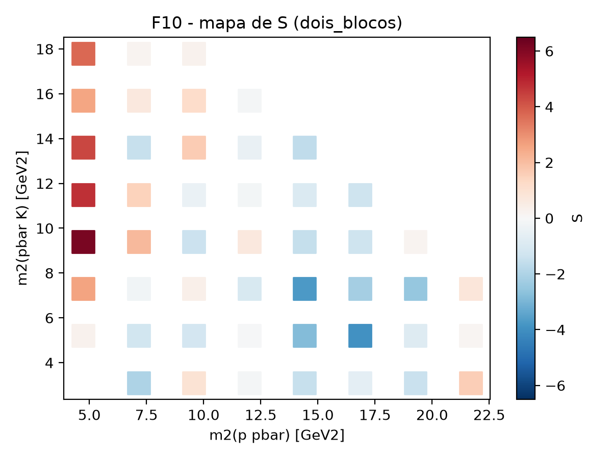
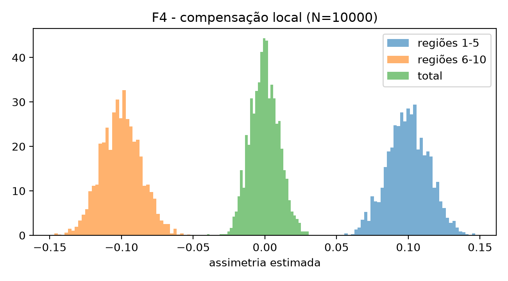
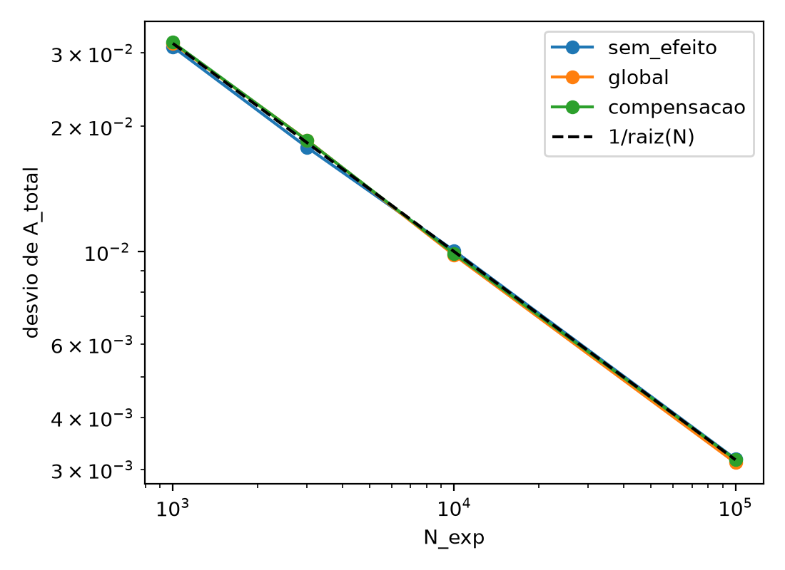
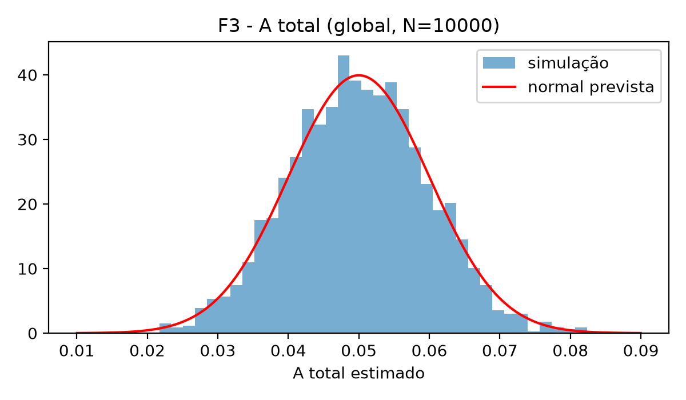
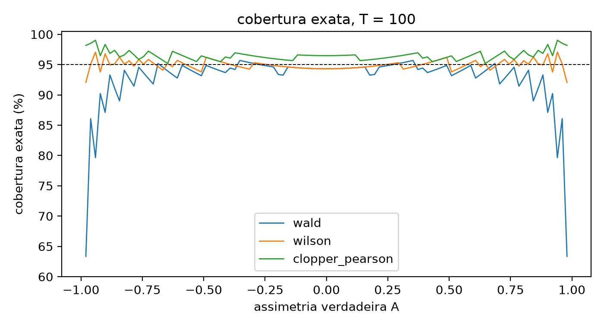
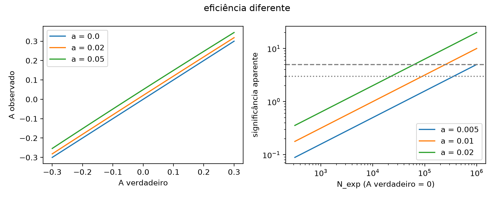
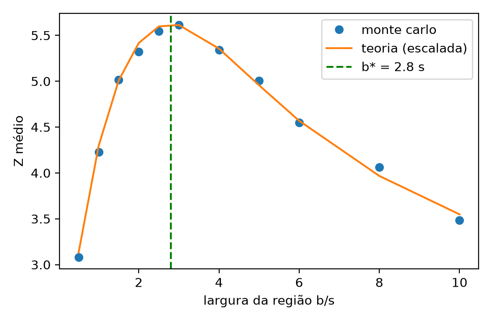

# Assimetrias entre B⁻ e B⁺ com dados simulados

**Resumo.** O erro de $A$ cai com $1/\sqrt{N}$ (inclinação −0,50 em escala log-log). Com ~10 eventos por região e $A$ = 0,8, o intervalo de Wald cobre só 63 %, contra 96 % do Wilson. A janela ótima em m(p p̄) tem largura b*/s ≈ 2,8 (largura da janela em unidades da largura $s$ do sinal). No plano de Dalitz, dois blocos de sinais opostos que se cancelam na contagem total (p = 0,97) aparecem no mapa de $S_j$ (máximo +6,17) e no teste $\chi^2_\mathrm{hom}$ (p ≈ 1,3×10⁻²⁰). Tudo com dados simulados. A tabela de verificação (`resultados/verificacao.csv`) compara cada método com uma referência independente (conta feita à mão, soma exata ou scipy).



*F10: mapa de $S_j$ no plano de Dalitz, cenário `dois_blocos`. Vermelho: excesso de B⁻; azul: excesso de B⁺.*

Na física de partículas, a violação de CP mede a diferença de comportamento entre partículas e antipartículas. Ela é uma das condições de Sakharov (1967) necessárias para explicar por que há mais matéria do que antimatéria no Universo, mas a violação de CP que vem da matriz CKM do Modelo Padrão (Thomson, 2013) é pequena demais (por várias ordens de grandeza) para explicar sozinha a assimetria cosmológica observada.

Este repositório reúne um estudo com dados simulados (Monte Carlo) para testar estimadores, intervalos de confiança e testes de hipótese usados em medidas de assimetria, usando como motivação física a cinemática do decaimento de três corpos B± → p p̄ K± estudado pelo LHCb (LHCb Collaboration, 2014). Os artigos experimentais citados servem apenas para motivar o problema e as escalas cinemáticas (não há dados reais nem validação direta das medidas do detector): eu escolho os valores de assimetria no arquivo de configuração, sorteio as contagens de Poisson para B⁻ ($N^-$) e B⁺ ($N^+$) e verifico se as contas recuperam o que foi colocado a partir da definição

$$A = \frac{N^- - N^+}{N^- + N^+}.$$

## Notação

| Símbolo | Significado |
|---|---|
| $N^-$, $N^+$ | contagens de B⁻ e B⁺, sorteadas de uma Poisson |
| $T = N^- + N^+$ | total observado no conjunto analisado (o total, uma região ou um bin); $T_j$ é o do bin $j$ |
| $N$, $N_\mathrm{exp}$ | número esperado de eventos no total (10³, 10⁴ e 10⁵ na etapa 1; 20 000 na etapa 3) |
| $\lambda$ | média de Poisson de $T$ (por exemplo, $\lambda = N w_i$ numa região) |
| $k$, $M$ | número de regiões (10) e de repetições do Monte Carlo (2000) |
| $w_i$ | peso da região $i$ (0,1 na etapa 1; calculado do espaço de fase na etapa 2) |
| $A$, $A_i$, $A_\mathrm{total}$ | assimetria verdadeira (em geral, na região $i$ e no total) |
| $\hat A$, $\sigma_A$ | assimetria estimada e seu desvio previsto |
| $\alpha = N^-/N^+$ | razão entre as contagens totais de B⁻ e B⁺ |
| $S_j$ | significância local no bin $j$ (etapa 3) |
| $a$, $\sigma_a$ | assimetria de eficiência, $a = (\varepsilon^- - \varepsilon^+)/(\varepsilon^- + \varepsilon^+)$, e sua incerteza |
| $A_\mathrm{obs}$ | assimetria observada quando as eficiências de B⁻ e B⁺ diferem |
| $m_0$, $s$, $b$ | centro e largura do sinal gaussiano em m(p p̄) e largura da janela de integração |

O desvio previsto de $A$ é

$$\sigma_A = \sqrt{\frac{1 - A^2}{T}}.$$

Nas comparações com a simulação, $T$ é trocado pelo seu valor médio. Para o total, esse valor é ≈ $N_\mathrm{exp}$: por isso o desvio previsto é 0,0316 = 1/√1000 quando $N_\mathrm{exp}$ = 1000.

## Etapas e montagem

### Etapa 1: estimadores, intervalos e testes

O espaço é dividido em $k$ = 10 regiões de mesmo peso ($w_i$ = 0,1) e cada configuração é repetida $M$ = 2000 vezes para $N_\mathrm{exp}$ = 10³, 10⁴ e 10⁵ eventos esperados, comparando três cenários:
* `sem_efeito`: $A_i$ = 0 em todas as 10 regiões ($A_\mathrm{total}$ = 0);
* `global`: $A_i$ = +0,05 em todas as regiões ($A_\mathrm{total}$ = +0,05);
* `compensacao`: $A_i$ = +0,10 nas regiões 1 a 5 e $A_i$ = −0,10 nas regiões 6 a 10 ($A_\mathrm{total}$ = 0).

Os intervalos comparados são Wald, Wilson e Clopper-Pearson (95 %), convertidos de $p = N^-/T$ para $A = 2p - 1$ (Brown, Cai e DasGupta, 2001). Os testes são o binomial bilateral do total e o $\chi^2$ de homogeneidade entre regiões ($\chi^2_\mathrm{hom}$).

### Etapa 2: espaço de fase em m(p p̄) e largura da janela

Os pesos cinemáticos $w_i$ das 10 faixas deixam de ser iguais. Cada um é a integral, pela regra do trapézio (Landau, Páez e Bordeianu, 2024), de $2m\,[s_{23}^{\max}(m^2) - s_{23}^{\min}(m^2)]$ (de $ds_{12} = 2m\,dm$) sobre a faixa $i$, com as 10 faixas de mesma largura em m(p p̄) ∈ [2$m_p$, $M_B - m_K$] = [1,8765; 4,7856] GeV (massas do PDG), e normalizada para somar 1. Os valores estão em `resultados/etapa2_pesos.csv`. Para estudar um efeito localizado perto do limiar bariônico, apliquei um perfil gaussiano unidimensional

$$A(m) = A_0 \exp\left[-\frac{(m - m_0)^2}{2 s^2}\right],$$

centrado em $m_0$ = 2,2 GeV (com $A_0$ = 0,20 e largura $s$ = 0,15 GeV).

### Etapa 3: mapa de significância no plano de Dalitz

Sorteei 20 000 eventos na região cinemática bidimensional ($s_{12}$, $s_{23}$) de B± → p p̄ K± e calculei em cada bin a significância descontando a razão total $\alpha$,

$$S_j = \frac{N^-_j - \alpha N^+_j}{\sqrt{\alpha T_j}},$$

baseada no método de Bediaga et al. (2009). No cenário `dois_blocos` (parâmetros em `config.json`), coloquei dois blocos gaussianos bidimensionais no plano ($s_{12}$, $s_{23}$): um com $A_0$ = +0,30 em (4,5; 12,0) GeV² e larguras (1,2; 4,0) GeV², e outro mais largo com $A_0$ = −0,15 em (15,0; 6,0) GeV² e larguras (3,0; 2,5) GeV². Os dois blocos têm sinais opostos para que se anulem quase por completo na contagem total (a média esperada dos perfis sobre a região cinemática dá $A_\mathrm{total}$ esperado ≈ −0,003, com erro estatístico $1/\sqrt{N}$ ≈ 0,007 para $N$ = 20 000).

## Principais resultados

### 1. Compensação local e resumo da etapa 1

*Pergunta: um teste sobre o total enxerga duas metades do espaço com assimetrias opostas?*

No cenário `compensacao`, como todas as regiões têm o mesmo peso, na soma total uma metade cancela a outra e $A_\mathrm{total}$ esperado dá zero.



*F4: histogramas de $\hat A$ em $N$ = 10⁴ para as regiões 1 a 5, as regiões 6 a 10 e o total (verde).*

Com $N$ = 10 000, o histograma do total (verde) fica centrado em zero e o teste binomial global rejeita H0 em 4,6 ± 0,5 % das vezes (compatível com o falso positivo nominal de 5 %). Já o teste qui-quadrado de homogeneidade ($\chi^2_\mathrm{hom}$), que compara as 10 regiões entre si, detecta a assimetria em 100 % das repetições a partir de $N$ = 10 000. Esse cenário de brinquedo foi motivado pela troca de sinal entre regiões do espaço de fase e pela compensação ππ ↔ KK entre canais discutidas pelo LHCb (2023).

Resumo das 9 configurações, salvo em `resultados/metricas.csv` (as definições das colunas estão em *Detalhes numéricos*):

| Cenário | $N_\mathrm{exp}$ | $A$ verdadeiro | Viés médio | Desvio obs. | Desvio prev. | Rejeição total | Rejeição $\chi^2_\mathrm{hom}$ |
|---|---:|---:|---:|---:|---:|---:|---:|
| sem_efeito | 1000 | 0,00 | +0,0005 | 0,0310 | 0,0316 | 4,2 % | 5,0 % |
| sem_efeito | 10000 | 0,00 | −0,0002 | 0,0100 | 0,0100 | 4,9 % | 5,3 % |
| sem_efeito | 100000 | 0,00 | 0,0000 | 0,0032 | 0,0032 | 4,8 % | 4,9 % |
| global | 1000 | 0,05 | +0,0004 | 0,0316 | 0,0316 | 34,7 % | 4,9 % |
| global | 10000 | 0,05 | 0,0000 | 0,0098 | 0,0100 | 99,95 % | 5,4 % |
| global | 100000 | 0,05 | −0,0001 | 0,0031 | 0,0032 | 100 % | 5,4 % |
| compensacao | 1000 | 0,00 | +0,0002 | 0,0318 | 0,0316 | 5,1 % | 55,4 % |
| compensacao | 10000 | 0,00 | −0,0002 | 0,0099 | 0,0100 | 4,6 % | 100 % |
| compensacao | 100000 | 0,00 | −0,0001 | 0,0032 | 0,0032 | 5,1 % | 100 % |

Atenção ao que cada coluna de rejeição mede em cada cenário. "Rejeição total" é falso positivo (esperado ≈ 5 %) em `sem_efeito` e `compensacao` ($A_\mathrm{total}$ = 0) e poder em `global`. "Rejeição $\chi^2_\mathrm{hom}$" é falso positivo em `sem_efeito` e `global` (assimetria igual em todas as regiões) e poder em `compensacao`.

### 2. Queda do erro com 1/√N e distribuição de pull

Pela variância da soma das contagens independentes (Blitzstein e Hwang, 2019), o desvio-padrão de $\hat A$ cai com $1/\sqrt{N}$, enquanto o teorema do limite central garante que o formato do histograma fica gaussiano quando $N$ cresce (Cowan, 1998; Wasserman, 2004).



*F5: desvio de $A_\mathrm{total}$ contra $N_\mathrm{exp}$ (log-log); a linha tracejada é $1/\sqrt{N}$.*

Nos sorteios principais ($N$ = 10³, 10⁴ e 10⁵, um fator 100), a razão entre o desvio em 10³ e o desvio em 10⁵ ficou perto de 10 nos três cenários (de 9,8 a 10,2). Como 3 pontos igualmente espaçados em $\log N$ fazem a inclinação de mínimos quadrados depender só das pontas, rodei também $N$ = 3000 para a figura F5. Com os 4 pontos, as inclinações em escala log-log ficaram entre −0,49 e −0,51 (esperado: −0,50 ± 0,02).

O pull, $(\hat A - A)/\hat\sigma_A$, deu média perto de zero e desvio 0,98 no `global` em $N$ = 10⁴ (0,98 a 1,01 nas nove configurações), então não vejo viés e o erro está bem estimado. Se o formato é gaussiano, só vi isso no histograma (F3); não fiz teste de normalidade.



*F3: histograma de $\hat A_\mathrm{total}$ (`global`, $N$ = 10⁴) contra a normal prevista (vermelho).*

### 3. Intervalos de confiança e cobertura



*F6: cobertura exata dos três intervalos contra $A$, com $T$ = 100; a linha tracejada marca 95 %.*

Na curva exata com $T$ = 100, o intervalo de Wald cai quando $A$ chega perto de ±1 e chega a 63,3 % no extremo plotado ($\lvert A\rvert$ = 0,98). Com poucos eventos por região ($N_\mathrm{exp}$ = 100, $T$ ≈ 10 e $A$ = 0,8; `resultados/cobertura_estresse.csv`), Wald cobre cerca de 63 % (a soma exata e o Monte Carlo concordam), Wilson cerca de 96 % e Clopper-Pearson 99 %.

### 4. Eficiência diferente entre B⁻ e B⁺

*Pergunta: uma diferença de eficiência de detecção cria uma assimetria falsa? Dá para corrigir?*

Como o detector é feito de matéria, K⁻ e K⁺ interagem de forma diferente e o K⁻ sofre maior absorção nuclear (Thomson, 2013), de modo que fica $\varepsilon^- < \varepsilon^+$ ($a < 0$). Usei $a$ = −0,02 (−2 %) na simulação. Com $N^\pm \propto \varepsilon^\pm (1 \pm A)$, a assimetria observada e a correção são

$$A_\mathrm{obs} = \frac{A + a}{1 + aA}, \qquad A = \frac{A_\mathrm{obs} - a}{1 - a A_\mathrm{obs}}.$$

Com $A$ = 0, $A_\mathrm{obs} = a$. Na figura abaixo (`F8_eficiencia.png`), as curvas teóricas desenham $a$ positivo (em módulo) para ilustrar o comportamento do viés e da significância aparente.



*F8: à esquerda, $A_\mathrm{obs}$ contra $A$ para $a$ = 0; 0,02 e 0,05. À direita, significância aparente contra $N_\mathrm{exp}$ (com $A$ = 0) para $a$ = 0,005; 0,01 e 0,02; as linhas cinzas marcam 3σ e 5σ.*

Os resultados dos sorteios com $a$ = −0,02 estão em `resultados/eficiencia_resumo.csv`:

* Sem corrigir: com $A$ = 0, a média observada fica em ~ −0,02. Como o erro estatístico cai com $1/\sqrt{N}$, a significância aparente em módulo sobe no Monte Carlo de 0,66σ ($N$ = 10³) e 1,96σ ($N$ = 10⁴) para 6,32σ em $N$ = 10⁵ (contra $\lvert a\rvert\sqrt{N}$ = 0,63σ, 2,00σ e 6,32σ esperados), dando 100 % de falsas descobertas em $N$ = 10⁵.
* Corrigindo com $a$ exato: aplicar a correção sobre $A_\mathrm{obs}$ devolve $A$ com erro menor que 10⁻¹² quando testada direto na fórmula. Nos sorteios de Monte Carlo com $a$ = −0,02 conhecido sem erro, o viés médio depois de corrigir zera até o ruído estatístico da amostra (~10⁻⁴ em $N$ = 10⁵, onde a média ficou em 3×10⁻⁵).
* Com incerteza de calibração em $a$ ($\sigma_a$ = 0,005, ou 0,5 ponto percentual): quando $a$ é sorteado com incerteza gaussiana $\sigma_a$ = 0,005 em $N$ = 10⁵ (linha `sigma_a = 0.005` de `resultados/eficiencia_resumo.csv`), o desvio-padrão de $A$ corrigido sobe de 0,00314 (0,31 %; só estatístico: 0,00316) para 0,00596 (0,60 %), contra $\sqrt{\sigma_A^2 + \sigma_a^2}$ = 0,00592 esperado. Com amostra grande, é a incerteza em $a$ que limita a medida.

### 5. Espaço de fase em m(p p̄) e largura da janela (etapa 2)

*Pergunta: que largura de janela em m(p p̄) maximiza a significância de um efeito localizado?*



*F9: significância média $Z$ contra $b/s$. Pontos: Monte Carlo; linha: teoria (escalada); tracejado verde: b*.*

Integrando os eventos numa janela $[m_0 - b/2,\ m_0 + b/2]$, o sinal acumulado cresce com $\mathrm{erf}\left(b/(2\sqrt{2}s)\right)$ e a incerteza estatística da contagem cresce com $\sqrt{b}$, de modo que a significância esperada

$$Z(b) \propto \frac{\mathrm{erf}\left(\frac{b}{2\sqrt{2}s}\right)}{\sqrt{b}}$$

é máxima quando b*/s ≈ 2,8. Esse valor vale para este modelo idealizado (sinal gaussiano 1D sobre densidade local uniforme, sem fundo e sem interferência entre amplitudes).

### 6. Plano de Dalitz de B± → p p̄ K± (etapa 3)

*Pergunta: o mapa de $S_j$ revela dois blocos que se cancelam na contagem total?*

O mapa é a figura F10, no início deste README. Pelos valores salvos em `resultados/etapa3_dalitz.csv`, o bin mais alto do bloco positivo chega a $S$ = +6,17 e o do bloco negativo a $S$ = −3,95. Esses valores são máximos entre vários bins, e não significâncias isoladas; o teste global é o $\chi^2_\mathrm{hom}$ nos 48 bins com pelo menos 20 eventos, que dá p = 1,3×10⁻²⁰. Já na contagem total do plano, a soma dos dois blocos no sorteio deu $A_\mathrm{total}$ = −0,0003 (dentro do esperado de −0,003 ± 0,007) e valor-p binomial `p_total` ≈ 0,97 (valor completo em `etapa3_dalitz.csv`).

## Detalhes numéricos

* **Tabela da seção 1.** O desvio previsto é $\sqrt{(1 - A^2)/\bar T}$, com $\bar T$ o valor médio de $T$ (≈ $N_\mathrm{exp}$ no total). A incerteza do viés na coluna `erro_vies` é $\sigma_A/\sqrt{M}$ ≈ 0,0007, 0,0002 e 0,00007 para $N$ = 10³, 10⁴ e 10⁵. A rejeição a 5 % compara o teste binomial bilateral do total com o teste $\chi^2_\mathrm{hom}$ entre regiões. No teste binomial, o valor-p é o dobro da cauda acumulada de min($N^-$, $N^+$), limitado a 1. O poder de referência é avaliado com $T$ fixo, e o Monte Carlo sorteia $T$ de uma Poisson.
* **Cobertura exata (seção 3).** Para manter a execução em cerca de 2 minutos, a soma binomial em $k$ foi avaliada na janela de ±7σ em torno de $np$ e a média sobre $T$ de Poisson em $\pm 5\sqrt{\lambda}$, somando todos os inteiros até $\lambda$ = 200 e usando uma aproximação numérica (amostrando uma malha espaçada de pontos de $T$) para $\lambda > 200$. Os números das seções 1 a 6 não usam essa aproximação ($T$ = 100 e $T$ ≈ 10 usam a soma exata); ela só entra na comparação entre o Monte Carlo e a soma exata para $N$ = 10⁴ e 10⁵ (`F6_cobertura_mc.png` e o item 11 da tabela de verificação, com 0 de 54 comparações fora de 3σ). Dobrar a densidade dessa malha (de 21 para 42 pontos) altera a cobertura em até 1,1 ponto percentual no pior caso testado (Wald, $\lambda$ = 300, $A$ = 0,98) e em menos de 0,35 ponto percentual nos demais ($\lambda$ = 300, 1000 e 10000; $A$ de −0,90 a 0,98).
* **Largura ótima (seção 5).** O valor b*/s ≈ 2,80 saiu de três cálculos: 2,798 por bisseção, 2,79 na varredura analítica e 3 na malha discreta de Monte Carlo (`F9_largura.png`).

## O que ficou de fora

* Fundo: a simulação não inclui eventos de fundo. Para um fundo simples sem assimetria (B eventos de fundo e S de sinal), o erro estatístico na assimetria do sinal sobe pelo fator $\sqrt{1 + B/S}$ (Thomson, 2013).
* Eficiência constante e assimetria de produção: na medida real em colisões p p, a assimetria bruta soma a violação de CP com as assimetrias de detecção e de produção dos mésons B⁻ e B⁺ (que nas análises do LHCb é medida usando canais de controle como B± → J/ψ K±; LHCb Collaboration, 2023). Aqui a eficiência testada não varia com o momento nem com a posição no Dalitz; na etapa 3, a razão global $\alpha$ em $S_j$ já desconta uma assimetria global constante de produção ou detecção antes de avaliar as variações locais.
* Sem interferência: a assimetria local foi parametrizada direto como um perfil gaussiano unidimensional em m(p p̄) na etapa 2 e como gaussianas bidimensionais em ($s_{12}$, $s_{23}$) no plano de Dalitz na etapa 3, sem somar amplitudes complexas ressonantes com fase forte e fase fraca.

## Como reproduzir os resultados

Estrutura do repositório:

```text
assimetrias-b-mc/
├── src/              # funções: estimadores, intervalos, cobertura, testes, espaço de fase, Dalitz
├── config.json       # semente fixa, cenários e parâmetros
├── rodar_tudo.py     # gera resultados/ e figuras/ e roda a tabela de verificação
├── resultados/       # tabelas em CSV (inclui verificacao.csv)
├── figuras/          # gráficos F1 a F10 (só parte deles aparece neste README)
├── notebook.ipynb    # roteiro curto que lê os arquivos salvos por rodar_tudo.py
└── requirements.txt
```

O notebook percorre um experimento único, as 2000 repetições, a cobertura, a compensação local, a eficiência, as etapas 2 e 3 e a tabela de verificação. Ele depende dos arquivos de `resultados/`, então `rodar_tudo.py` deve rodar antes.

Para gerar novamente as tabelas na pasta `resultados/` e os gráficos em `figuras/` (testado em Python 3.12; leva ~2 min com a semente fixa configurada em `config.json`):

```bash
pip install -r requirements.txt
python rodar_tudo.py
jupyter notebook notebook.ipynb
```

## Referências

* A. D. Sakharov, *Violation of CP Invariance, C Asymmetry, and Baryon Asymmetry of the Universe*, Pisma Zh. Eksp. Teor. Fiz. 5 (1967) 32 [JETP Lett. 5 (1967) 24].
* M. Thomson, *Modern Particle Physics*, Cambridge University Press, 2013.
* G. Cowan, *Statistical Data Analysis*, Oxford University Press, 1998.
* L. Wasserman, *All of Statistics: A Concise Course in Statistical Inference*, Springer, 2004.
* J. K. Blitzstein, J. Hwang, *Introduction to Probability*, 2nd ed., CRC Press, 2019.
* L. D. Brown, T. T. Cai, A. DasGupta, *Interval Estimation for a Binomial Proportion*, Statistical Science 16 (2001) 101.
* R. H. Landau, M. J. Páez, C. C. Bordeianu, *Computational Physics: Problem Solving with Python*, 4th ed., Wiley-VCH, 2024.
* I. Bediaga et al., *On a CP anisotropy measurement in the Dalitz plot*, Phys. Rev. D 80 (2009) 096006.
* LHCb Collaboration, *Direct CP violation in charmless three-body decays of B± mesons*, Phys. Rev. D 108 (2023) 012008.
* LHCb Collaboration, *Evidence for CP Violation in B+ → p p̄ K+ Decays*, Phys. Rev. Lett. 113 (2014) 141801.
